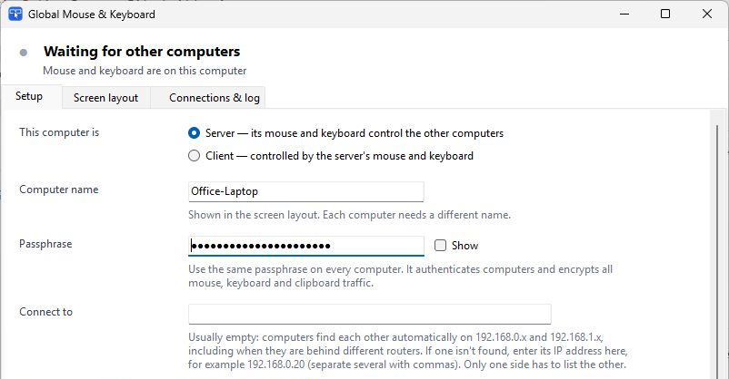

# Global Mouse & Keyboard

Global Mouse & Keyboard lets you use one mouse and keyboard across several Windows computers. Move the pointer off one screen and onto the next, and your keyboard follows. Text and images copied to the clipboard are shared too.

The app usually finds nearby computers automatically. Connections are encrypted and protected by a passphrase you choose. Normal use requires no installer: run `GlobalMK.exe` on each computer.

Licensed under GPL-3.0-only. See [LICENSE](LICENSE) for the license identifier and a link to the full text.

## Set it up

You’ll need Windows 10 or 11 and a passphrase of at least 8 characters. Use the same passphrase on every computer.

### On the computer with the mouse and keyboard

1. Run `GlobalMK.exe` and choose **Server** on the **Setup** tab.
2. Give the computer a unique name and enter your passphrase.
3. Choose **Save & apply**, then choose **Allow through Windows Firewall…** and approve the Windows prompt.

### On each computer you want to control

1. Run `GlobalMK.exe` and choose **Client** on the **Setup** tab.
2. Give it a different name and enter the same passphrase as the server.
3. Choose **Save & apply**, then allow the app through Windows Firewall.

When connected, the client shows **Controlled by** and the server's name. On the server, open **Screen layout** and drag the computers into the positions that match your desks. Screens need to touch or overlap along the edge where you want the pointer to cross. The layout saves automatically.

Close the app window to leave it running in the notification area. Right-click its tray icon and choose **Exit** to quit.

## Example setup

Say your laptop has the mouse and keyboard, and you want to control a desktop beside it:

| Computer | Role | Name | Passphrase |
| --- | --- | --- | --- |
| Laptop | Server | `Office-Laptop` | Your chosen passphrase |
| Desktop | Client | `Office-Desktop` | The same passphrase |

Start with the laptop setup, then configure the desktop as a client. On the laptop, place `Office-Desktop` to the left or right of `Office-Laptop` in **Screen layout**, matching where the desktop sits on your desk. Use a private passphrase; don’t put it in screenshots or share it.

## Screenshots

### Setup



The setup view uses sample values. The passphrase is masked, and the image is cropped to leave out computer-specific network addresses.

## Troubleshooting

- **Computers don’t connect:** Check that one is set to **Server** and the others to **Client**, that names are unique, and that the passphrases match. Allow the app through Windows Firewall on each computer.
- **A computer isn’t found:** Wait about a minute. You can enter its address in **Connect to** on the **Setup** tab.
- **The pointer won’t cross:** Check the layout on the server and make sure the screens meet along the edge you’re trying to cross. Scroll Lock may also be on; press it again to unlock.
- **Clipboard isn’t shared:** Make sure **Share the clipboard** is enabled on both computers. Text and images are supported; files are not.
- **More help:** The **Connections & log** tab shows connection details. Settings and logs are in `%APPDATA%\GlobalMK\`.

## Technical notes

- Windows only. macOS and Linux aren’t supported.
- The app uses TCP port 24860 for input and clipboard traffic and UDP port 24861 for discovery. The ports can be changed in **Setup**.
- Discovery works automatically on the same network and on common home networks using `192.168.0.x` and `192.168.1.x`. For other network setups, enter the other computer's address manually. Tailscale or a similar private network can help connect computers on separate networks.
- An optional helper service lets the shared input work on a client's lock screen and UAC prompts. Installing it requires administrator rights; see **Lock screen and UAC prompts** on the **Setup** tab.
- Windows restricts some actions: Ctrl+Alt+Del always applies to the server, and a client app cannot accept input at the sign-in screen before someone signs in after a restart.
- Connections use a shared passphrase for authentication and encryption. Use a passphrase others can’t guess, especially if you enable the helper service.

## Build from source

To build on Windows, install the .NET SDK 6 or later and the .NET Framework 4.8 Developer Pack. Then open PowerShell in the repository folder and run:

```powershell
powershell -ExecutionPolicy Bypass -File build.ps1
```

The script builds `dist\GlobalMK.exe` and runs the self-tests. The tests cover core networking, encryption, clipboard transfer, screen layout, discovery and helper communication; they don’t install input hooks or the helper service.

The app is in `src/GlobalMK`, and its self-tests are in `tests/GlobalMK.Tests`.

## License

GPL-3.0-only. See [LICENSE](LICENSE) for the license identifier and a link to the full text.
